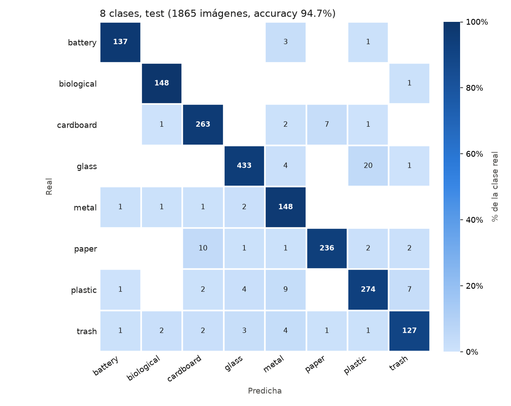
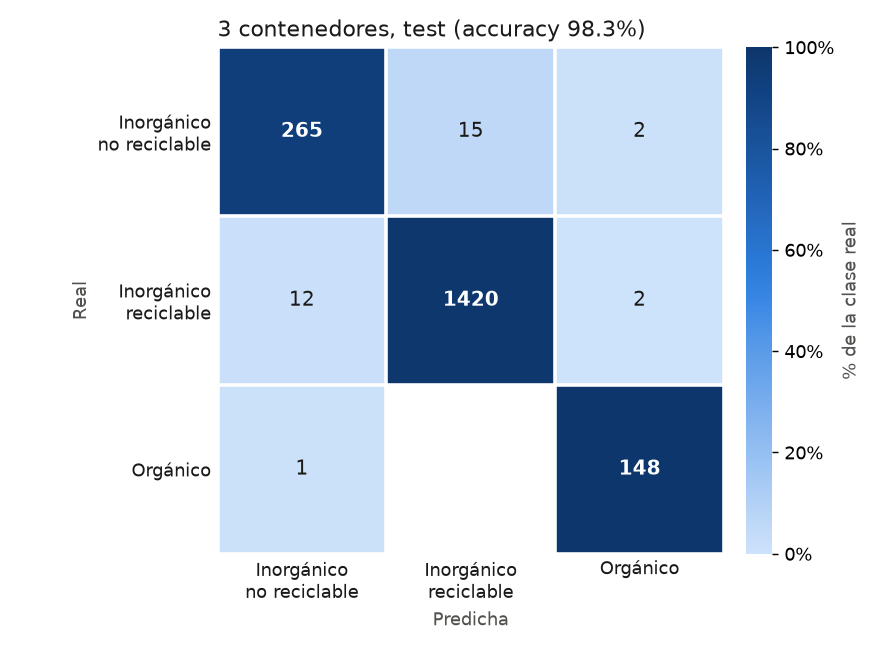

# Clasificación de residuos (DATALAB)

Modelo de visión para un módulo de basura inteligente. Una cámara cenital toma
una foto del residuo, el modelo lo clasifica en 8 clases y una tabla manda cada
clase a uno de 3 contenedores: orgánico, inorgánico reciclable e inorgánico no
reciclable.

Equipo de software/IA: Emilio Juárez Ávalos y Alejandro Martínez, junto con el
equipo de Makers (estructura física y microcontroladores).

## Estructura

| Ruta | Qué es |
|---|---|
| `src/config.py` | Clases, mapeo a contenedores, semilla y rutas compartidas |
| `src/preparar_datos.py` | Extrae el dataset, corrige formatos, quita duplicados y hace el split |
| `src/modelo.py` | Carga de datos (tf.data), aumento y armado del modelo; lo usan ambas etapas |
| `src/prueba_redes.py` | Prueba corta para elegir la red preentrenada |
| `src/entrenar_base_congelada.py` | Entrenamiento completo con la base congelada (etapa 2, paso 1) |
| `src/fine_tuning.py` | Fine-tuning: descongela las últimas capas con lr bajo (etapa 2, paso 2) |
| `src/evaluar.py` | Métricas de un modelo guardado: accuracy, F1, MCC, por clase y por contenedor |
| `src/curvas.py` | Lectura del historial y gráfica de error por época |
| `src/exportar_tflite.py` | Convierte el modelo final a TFLite y lo compara con Keras |
| `src/inferir.py` | Clasifica fotos con el `.tflite`; no necesita TensorFlow |
| `demo/` | Demo web: elige fotos por contenedor y clase y ve qué responde el modelo |
| `.github/workflows/demo.yml` | Construye el demo y lo publica en GitHub Pages |
| `notebooks/prueba_redes.ipynb` | Corre la prueba corta en Colab con GPU |
| `entorno/` | Versiones fijas y script para crear el entorno con GPU en WSL2/Linux |
| `resultados/` | Métricas y gráficas que se suben al repo (los modelos `.keras`/`.tflite` no) |
| `datos/` | Split y archivos JSON generados (se suben a git) |
| `data/imagenes/` | Imágenes extraídas (no se suben, las genera el script) |
| `Datasets/` | Zip original de Kaggle (no se sube, 780 MB) |
| `reportes/` | Reportes internos de avances para DATALAB |
| `viejo_modelo/` | Modelo del semestre anterior, solo como referencia |

## Dataset

[Garbage Classification V2](https://www.kaggle.com/datasets/sumn2u/garbage-classification-v2)
(Suman Kunwar, Kaggle). Se usan 8 de sus 10 clases. Se descartan `clothes` y
`shoes` porque no son residuos que separa el módulo. Quedan 12,428 imágenes
(sin los 30 duplicados `.jpg`/`.png` que trae el zip).

Se usa la **versión 8** del dataset (diciembre 2024); las versiones posteriores
cambian las imágenes y por lo tanto el split.

| Clase | Contenedor |
|---|---|
| biological | Orgánico |
| cardboard, glass, metal, paper, plastic | Inorgánico reciclable |
| battery (manejo especial), trash | Inorgánico no reciclable |

## Entorno

- **Colab:** basta con `pip install -r requirements.txt`.
- **Entrenamiento local con GPU NVIDIA (Linux o WSL2):** usa las versiones
  exactas de `entorno/requirements-gpu.lock` (Python 3.12, TensorFlow 2.21.0,
  CUDA 12.9 y cuDNN 9 instalados por pip). Necesitas el driver de NVIDIA (en
  WSL2 basta el de Windows) y [uv](https://docs.astral.sh/uv/). Dentro de WSL,
  desde la raíz del repo:

  ```bash
  bash entorno/crear_entorno_wsl.sh
  source ~/venvs/clasificacion_basura/bin/activate
  ```

  El script termina mostrando si TensorFlow detecta la GPU. TensorFlow no usa
  GPU en Windows nativo (desde la versión 2.11), por eso se entrena en WSL2.

## Preparar los datos

1. Descarga la versión 8 del zip (no hace falta cuenta de Kaggle) y guárdalo
   como `Datasets/2025-05-10_archive.zip`.
2. Desde la raíz del repo:

```bash
mkdir -p Datasets
curl -L -o Datasets/2025-05-10_archive.zip \
  "https://www.kaggle.com/api/v1/datasets/download/sumn2u/garbage-classification-v2?datasetVersionNumber=8"
pip install -r requirements.txt
python src/preparar_datos.py --zip Datasets/2025-05-10_archive.zip
```

El script:

- extrae solo las 8 clases a `data/imagenes/<clase>/`;
- abre cada imagen y la guarda como JPEG en RGB, lo que corrige los archivos
  con extensión `.jpg` que en realidad son PNG, WebP o MPO;
- resuelve los nombres repetidos (pares como `glass_20241.jpg` y
  `glass_20241.png`): si son la misma foto (mismo tamaño y diferencia promedio
  por píxel menor a 8 en escala 0-255) guarda solo la primera; si son fotos
  distintas, guarda la segunda como `glass_20241(1).jpg`. En la versión 8 los
  30 pares son la misma foto y se descartan;
- hace la partición 70/15/15 estratificada por clase con semilla 42;
- escribe en `datos/`:
  - `splits.csv`, con ruta, clase, partición, ancho y alto de cada imagen;
  - `clases.json`, con el índice de cada clase (el orden de salida del modelo);
  - `clases_a_contenedores.json`;
  - `class_weights.json`, con pesos `balanced` calculados solo con train;
  - `resumen_split.csv`, con el conteo por clase y partición.

Correrlo dos veces con el mismo zip da exactamente el mismo `splits.csv`.

Distribución de clases (12,428 imágenes; train 8,699, val 1,864 y test 1,865).
Al estratificar, cada partición tiene los mismos porcentajes que el total:

| Clase | Contenedor | Imágenes | % |
|---|---|---:|---:|
| glass | inorgánico reciclable | 3,054 | 24.6 |
| plastic | inorgánico reciclable | 1,976 | 15.9 |
| cardboard | inorgánico reciclable | 1,824 | 14.7 |
| paper | inorgánico reciclable | 1,678 | 13.5 |
| metal | inorgánico reciclable | 1,016 | 8.2 |
| biological | orgánico | 997 | 8.0 |
| battery | inorgánico no reciclable | 944 | 7.6 |
| trash | inorgánico no reciclable | 939 | 7.6 |

Por contenedor: reciclable 76.8 %, no reciclable 15.2 % y orgánico 8.0 %. El
desbalance se compensa con `class_weights.json` al entrenar.

En Colab: clona el repo, sube el zip a `Datasets/` (o enlázalo desde Drive) y
corre `!python src/preparar_datos.py`.

## Elegir la red preentrenada

Abre `notebooks/prueba_redes.ipynb` en Colab con GPU. Entrena MobileNetV3Large y
EfficientNetB0 con la base congelada durante 8 épocas como máximo y compara en
validación el F1 macro, el F1 de biological, la exactitud por contenedor y el
tiempo y tamaño en TensorFlow Lite. Los resultados quedan en
`resultados/prueba_redes/`.

### Resultados (validación, base congelada, 8 épocas)

> Estos resultados se obtuvieron con el split anterior, que tenía 30 fotos
> repetidas (7 de ellas en dos particiones a la vez). Al quitar los duplicados
> el split cambió por completo. Como son 30 imágenes de 12,458, no se espera
> que cambie la elección de la red, pero las cifras no son exactamente
> comparables con las del entrenamiento nuevo.

| Red | F1 macro | F1 biological | Acc. contenedor | TFLite (MB) | TFLite (ms/img, CPU) | Min. entrenamiento (CPU) |
|---|---:|---:|---:|---:|---:|---:|
| **MobileNetV3Large** | 0.916 | **0.974** | 0.975 | **3.6** | **6.6** | **9.3** |
| EfficientNetB0 | **0.922** | 0.970 | **0.976** | 4.9 | 7.7 | 15.0 |

F1 por clase en `resultados/prueba_redes/f1_por_clase.csv` y curvas en
`resultados/prueba_redes/curvas_*.png`. Los tiempos se midieron en un CPU de 4
núcleos con TFLite cuantizado (rango dinámico): sirven para comparar las redes,
no son el tiempo real en la placa del módulo.

**Red elegida: MobileNetV3Large.** La diferencia de F1 macro es de 0.006, menor
que el umbral de 0.02 que fijamos para considerarla relevante. Con el criterio
de desempate, MobileNetV3Large gana: tiene mejor F1 en biological (la clase más
débil), es un 27 % más chica, es un 14 % más rápida en TFLite y entrena en
casi la mitad del tiempo. Como la placa del módulo aún no está definida, conviene
la opción más ligera. EfficientNetB0 fue mejor en cardboard, paper y trash, así
que queda como alternativa si el fine-tuning de MobileNetV3Large se estanca.

En ambas redes la pérdida de validación seguía bajando en la época 8, así que
la etapa 2 (más épocas y fine-tuning) tiene margen de mejora.

## Entrenar con la base congelada

Primer paso de la etapa 2: entrena solo las capas nuevas de la red elegida
(`BASE_ELEGIDA` en `src/config.py`) y deja la red preentrenada sin cambios.

```bash
# en WSL, desde la raíz del repo (ver "Entorno"):
source ~/venvs/clasificacion_basura/bin/activate
python src/entrenar_base_congelada.py            # máx. 50 épocas, paciencia 4
python src/entrenar_base_congelada.py --epocas 80
```

- **Early stopping:** se detiene cuando `val_loss` lleva 4 épocas seguidas sin
  mejorar (`--paciencia`).
- **Checkpoint:** guarda el modelo solo cuando `val_loss` mejora, así que
  `modelo_base_congelada.keras` es el de la mejor época y no el de la última.
  Ese archivo es el punto de partida del fine-tuning.
- Si llega al máximo de épocas sin detenerse, avisa para subir `--epocas`.

Resultados en `resultados/base_congelada/`: `historial.csv` (error y accuracy
por época, se escribe al terminar cada época), `curva_error.png` (error contra
épocas, con la mejor época marcada), `resumen.json` y las métricas del
checkpoint en validación (ver "Evaluar un modelo"). El `.keras` no se sube a
git.

## Fine-tuning

Parte del checkpoint de la base congelada, descongela las últimas capas de
MobileNetV3Large con `descongelar_ultimas` (las BatchNormalization siguen
congeladas) y las reentrena con una tasa de aprendizaje baja.

```bash
python src/fine_tuning.py                        # 48 capas, lr 1e-5, paciencia 4
python src/fine_tuning.py --capas 33 --lr 1e-5
```

- `--capas` cuenta desde el final de la base (187 capas). 18, 33 y 48 cortan
  justo entre bloques; 48 (por defecto) descongela toda la última etapa
  (bloques 12 a 14 y la convolución final, ~2.4 M de parámetros).
- `--lr` 1e-5 por defecto, 100 veces menor que en la base congelada, para
  ajustar los pesos de ImageNet sin borrarlos.
- Antes de entrenar mide el `val_loss` del modelo de partida, y el checkpoint
  solo se guarda si el fine-tuning lo supera. Si nunca lo supera, no se guarda
  modelo y el de la base congelada sigue siendo el mejor.
- La gráfica marca con una línea el `val_loss` de partida para comparar.

Resultados en `resultados/fine_tuning/`, con los mismos archivos que la etapa
anterior.

## Evaluar un modelo

```bash
python src/evaluar.py --modelo resultados/base_congelada/modelo_base_congelada.keras
```

Los dos scripts de entrenamiento lo corren solos al terminar. Evalúa en
validación (test se reserva para el modelo final) y guarda junto al modelo:

- `metricas_val.json`: accuracy, F1 macro y **MCC** con las 8 clases y con los
  3 contenedores, y F1 de cada contenedor;
- `por_clase_val.csv`: precisión, recall, F1 y MCC de cada clase contra el
  resto;
- `matriz_confusion_val.csv` / `.png`: 8 clases, filas = clase real, columnas =
  predicha;
- `matriz_confusion_contenedor_val.csv` / `.png`: lo mismo con los 3
  contenedores.

En las imágenes el color es el porcentaje de la clase real (para comparar
clases de distinto tamaño) y el número de cada celda es el conteo. Para test:
`--particion test`.

**MCC** (coeficiente de correlación de Matthews) va de -1 a 1: 1 es predicción
perfecta y 0 equivale a adivinar. Usa toda la matriz de confusión, así que no
se infla con clases desbalanceadas como la accuracy: un modelo que siempre
dijera `glass` tendría 25 % de accuracy pero MCC de 0.

Entre corridas en GPU la accuracy puede variar en una o dos imágenes (unas
cuantas imágenes quedan casi empatadas entre dos clases y la GPU no hace las
operaciones exactamente en el mismo orden cada vez).

## Resultados del modelo final

Modelo: MobileNetV3Large con fine-tuning de las últimas 48 capas
(`resultados/fine_tuning/`). Test se evaluó una sola vez, con el modelo ya
elegido en validación.

| | Base congelada (val) | Fine-tuning (val) | **Fine-tuning (test)** |
|---|---:|---:|---:|
| Accuracy, 8 clases | 0.921 | 0.950 | **0.947** |
| F1 macro, 8 clases | 0.917 | 0.948 | **0.946** |
| MCC, 8 clases | 0.907 | 0.941 | **0.938** |
| Accuracy, 3 contenedores | 0.972 | 0.986 | **0.983** |
| MCC, 3 contenedores | 0.929 | 0.964 | **0.955** |

F1 por clase en test: biological 0.983, battery 0.975, glass 0.961, cardboard
0.953, paper 0.952, plastic 0.919, metal 0.914, trash 0.910. La confusión más
frecuente es vidrio predicho como plástico (20 de 458). De 141 baterías, 4 se
predicen como metal o plástico e irían al contenedor de reciclables, aunque
requieren manejo especial.




### Limitaciones

- **El modelo comete errores.** En test, 32 de 1,865 fotos (1.7 %) van al
  contenedor equivocado.
- **El análisis depende bastante del fondo.** Las fotos del dataset vienen de
  internet, con fondos y encuadres muy distintos a los que verá la cámara del
  módulo. Las cifras de arriba no garantizan el mismo desempeño en el bote.
- **Hay que revisar con cuidado la contaminación cruzada**, en especial
  orgánicos que terminen en inorgánicos reciclables. En test ningún orgánico
  se fue a reciclables (2 reciclables se predijeron como orgánicos), pero hay
  que confirmarlo con fotos reales tomadas en el módulo.

## Exportar a TFLite e inferencia

```bash
python src/exportar_tflite.py                    # float16 por defecto
python src/inferir.py foto.jpg                   # clase, probabilidad y contenedor
python src/inferir.py fotos/*.jpg --json         # una línea JSON por foto
```

`exportar_tflite.py` convierte `resultados/fine_tuning/modelo_fine_tuning.keras`
y deja en `resultados/tflite/` el `modelo.tflite` (no se sube a git),
`etiquetas.json` (clases, contenedores y cómo preparar la entrada) y
`resumen.json`. Antes de guardar el resumen pasa las mismas imágenes de val y
test por Keras y por TFLite y compara la clase predicha:

| `--cuantizacion` | Tamaño | ms/imagen (CPU, 4 hilos) | Clase distinta a Keras (val / test) | Accuracy test |
|---|---:|---:|---:|---:|
| **`float16`** (por defecto) | 6.6 MB | 2.1 | 1 / 2 | 0.947 |
| `dinamica` (int8) | 3.6 MB | 4.8 | 24 / 26 | 0.943 |
| `ninguna` (float32) | 12.9 MB | 2.2 | 0 / 0 | 0.947 |

Los tiempos son de una laptop x86 y sirven para comparar formatos, no son el
tiempo en la placa del módulo.

El `.tflite` tiene la entrada con lote fijo `[1, 224, 224, 3]` (una foto a la
vez), porque LiteRT.js en el navegador exige la forma exacta.

`inferir.py` prepara la imagen igual que en el entrenamiento: la abre y la
convierte a **RGB**, la redimensiona a 224x224 (bilineal, sin recortar) y la
pasa como float32 en **0-255, sin dividir entre 255** (MobileNetV3 normaliza por
dentro; dividiendo entre 255 el modelo responde `cardboard` para todo). Solo
necesita numpy, Pillow y un intérprete de TFLite (`ai_edge_litert`,
`tflite_runtime` o TensorFlow), así que para la placa basta copiar
`inferir.py`, `modelo.tflite` y `etiquetas.json`. Con OpenCV hay que convertir
de BGR a RGB antes de pasarle la imagen.

Verificado en las 1,865 imágenes de test: leyendo los archivos con Pillow la
accuracy es 0.946, contra 0.947 con la preparación de TensorFlow; 8 imágenes
cambian de clase por diferencias mínimas al decodificar y redimensionar.

## Demo

**[itam-datalab.github.io/Clasificacion_basura](https://itam-datalab.github.io/Clasificacion_basura/)**

Muestra las 1,865 fotos de test (que el modelo no vio al entrenar) con lo que
respondió el modelo final en TFLite:

- **Evaluar por contenedor (por defecto) o por clase:** define qué cuenta como
  acierto. Por contenedor, una botella de vidrio predicha como plástico es un
  acierto, porque va al mismo contenedor; por clase, es un error.
- **Filtros** por contenedor, por clase y por aciertos o errores. Al elegir una
  foto se ven las probabilidades de las 8 clases y el veredicto.
- **Probar con tu foto:** se elige o arrastra una foto (en el celular, también
  con la cámara) y se clasifica en el navegador con el mismo `modelo.tflite`,
  usando [LiteRT.js](https://www.npmjs.com/package/@litertjs/core). La foto no
  sale del navegador. Opcionalmente se indica qué es en realidad para ver el
  veredicto. La preparación replica la de `inferir.py` (RGB, 224x224 con el
  bilineal de Pillow, 0-255 sin dividir entre 255): en 200 fotos la clase
  coincide en las 200 y las probabilidades difieren a lo mucho 0.004.

Los filtros quedan en la URL para compartir una vista, por ejemplo
[las baterías que van al contenedor equivocado](https://itam-datalab.github.io/Clasificacion_basura/#clase=battery&mostrar=errores)
o [los errores de clase en reciclables](https://itam-datalab.github.io/Clasificacion_basura/#evaluar=clase&contenedor=inorganico_reciclable&mostrar=errores).

Lo construye y publica `.github/workflows/demo.yml` cada vez que cambian el
demo, el modelo o `inferir.py`, o a mano desde la pestaña Actions. El workflow
descarga el dataset (con caché), verifica que el split sea idéntico a
`datos/splits.csv`, clasifica las fotos con `inferir.py` usando `ai-edge-litert`
(sin TensorFlow, como en la placa) y sube el sitio a Pages.

Para verlo en local, después de `preparar_datos.py` y `exportar_tflite.py`:

```bash
python demo/construir.py
python -m http.server -d sitio 8000    # y abrir http://localhost:8000
```

## Modelo viejo

`viejo_modelo/` tiene el trabajo anterior. El código (`modelo.py`, una CNN
desde cero con 8 clases) no corresponde al archivo guardado (una MobileNetV2
congelada con 10 clases), no hay métricas y el split no era reproducible. Por
eso el modelo nuevo se construye desde cero sobre este repo.
