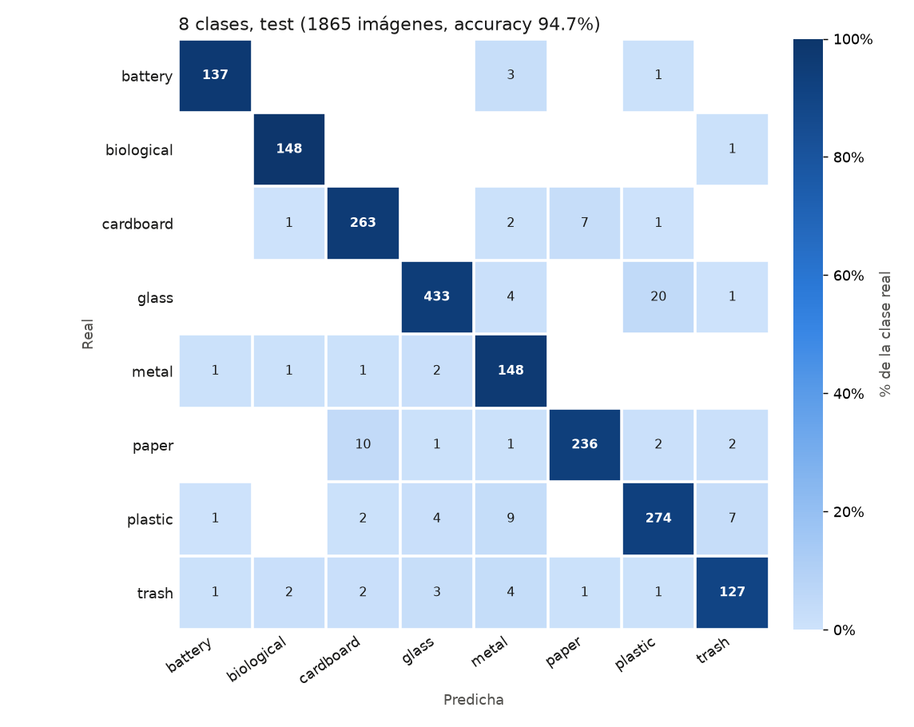
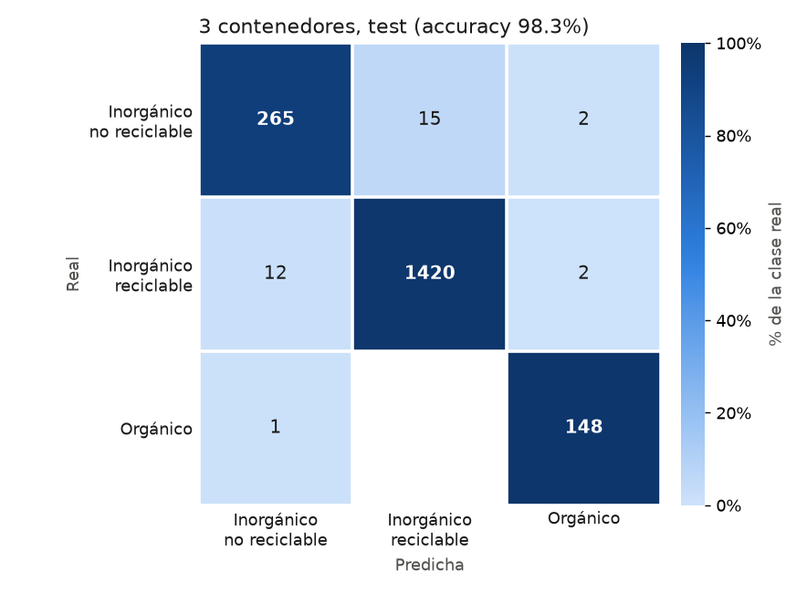

# Informe de la rama entrenamiento

24 de noviembre de 2026 · Alejandro Martínez

El modelo final (MobileNetV3Large con fine-tuning) clasifica bien el 94.7 % de las imágenes de test en 8 clases y el 98.3 % en los 3 contenedores, con MCC de 0.938. Para llegar ahí quitamos 30 fotos duplicadas del dataset, lo que cambió el split que usaste en la prueba de redes. Antes de pasar a la última fase necesitamos tus comentarios sobre los puntos de la sección final.

## Resultados

El fine-tuning bajó los errores en validación de 148 a 94 imágenes, y test confirma esos números: no hay señales de que el modelo se haya ajustado de más a validación. Test se evaluó una sola vez, con el modelo ya elegido.

| Métrica | Base congelada (val) | Fine-tuning (val) | Fine-tuning (test) |
| --- | --: | --: | --: |
| Accuracy, 8 clases | 0.921 | 0.950 | **0.947** |
| F1 macro, 8 clases | 0.917 | 0.948 | **0.946** |
| MCC, 8 clases | 0.907 | 0.941 | **0.938** |
| Accuracy, 3 contenedores | 0.972 | 0.986 | **0.983** |
| MCC, 3 contenedores | 0.929 | 0.964 | **0.955** |
| Imágenes mal clasificadas | 148 de 1,864 | 94 de 1,864 | 99 de 1,865 |

Métricas por clase en test, de la más débil a la más fuerte:

| Clase | Contenedor | Precisión | Recall | F1 | MCC | Imágenes |
| --- | --- | --: | --: | --: | --: | --: |
| trash | No reciclable | 0.920 | 0.901 | 0.910 | 0.903 | 141 |
| metal | Reciclable | 0.866 | 0.967 | 0.914 | 0.907 | 153 |
| plastic | Reciclable | 0.916 | 0.923 | 0.919 | 0.904 | 297 |
| paper | Reciclable | 0.967 | 0.936 | 0.952 | 0.944 | 252 |
| cardboard | Reciclable | 0.946 | 0.960 | 0.953 | 0.945 | 274 |
| glass | Reciclable | 0.977 | 0.945 | 0.961 | 0.949 | 458 |
| battery | No reciclable | 0.979 | 0.972 | 0.975 | 0.973 | 141 |
| biological | Orgánico | 0.974 | 0.993 | 0.983 | 0.982 | 149 |

Agregamos MCC (coeficiente de correlación de Matthews) porque, a diferencia de la accuracy, no se infla con clases desbalanceadas: glass tiene tres veces más imágenes que trash o battery.

## Cambio en los datos

El split ahora tiene 12,428 imágenes en lugar de 12,458, y todas las particiones cambiaron. El zip de Kaggle trae 30 pares con el mismo nombre, como `glass_20241.jpg` y `glass_20241.png`, y `preparar_datos.py` guardaba los dos en el mismo `glass_20241.jpg`.

- **El problema:** `splits.csv` tenía 30 rutas repetidas que apuntaban al mismo archivo. 7 de ellas estaban en dos particiones a la vez (4 en train y test, 2 en train y val, 1 en val y test), así que el modelo podía entrenar con fotos con las que después se evaluaba.
- **Lo que revisamos:** comparamos cada par píxel por píxel. Los 30 son la misma foto; la diferencia promedio va de 0.2 a 3.2 (escala 0–255) y viene solo de la compresión JPEG.
- **El cambio en `preparar_datos.py`:** si dos archivos van al mismo nombre y son la misma foto (mismo tamaño y diferencia promedio menor a 8), conserva el primero. Si fueran fotos distintas, guardaría el segundo como `nombre(1).jpg`; en este dataset no hubo ningún caso.
- **Versión del dataset:** confirmamos que el zip `2025-05-10_archive.zip` es la versión 8 de Kaggle, porque con ella el script reproduce exactamente tu `splits.csv` anterior. El README ahora tiene el comando para descargarla sin cuenta.

Tus resultados de la prueba de redes usaron el split anterior. Con 30 imágenes de diferencia no deberían cambiar la elección de MobileNetV3Large, pero las cifras ya no son exactamente comparables; lo anotamos en el README.

## Entrenamiento

Entrenamos en dos etapas sobre MobileNetV3Large, con early stopping sobre `val_loss` (paciencia 4) y un checkpoint que solo se guarda cuando `val_loss` mejora. Las dos corrieron en una RTX 4050 dentro de WSL2.

| Etapa | Qué se entrena | Parámetros entrenables | lr | Épocas corridas | Mejor época | `val_loss` | Tiempo |
| --- | --- | --: | --: | --: | --: | --: | --: |
| Base congelada | Solo la cabeza (Dense 256 + Dense 8) | 248,072 | 1e-3 | 8 (se detuvo sola) | 4 | 0.230 | 2.4 min |
| Fine-tuning | Cabeza + últimas 48 capas de la base | 2,414,288 | 1e-5 | 30 (el máximo) | 28 | 0.184 | 6.7 min |

- **Base congelada:** `val_loss` tocó su mínimo en la época 4 y después osciló entre 0.23 y 0.25, así que con la base fija no había mucho más que ganar.
- **Qué se descongeló:** las 48 capas son toda la última etapa de la red (bloques 12 a 14, a 7×7, y la convolución final). El corte cae entre bloques; 18 y 33 también caen. Las BatchNormalization siguen congeladas, como hace `descongelar_ultimas`.
- **Checkpoint del fine-tuning:** solo se guarda si supera el `val_loss` del modelo de partida (0.2298), para no reemplazarlo por uno peor. Lo superó desde la primera época.
- **Está cerca de su límite:** desde la época 20, `val_loss` solo bajó de 0.187 a 0.184 mientras el error de entrenamiento siguió bajando (0.10 contra 0.18). Más épocas darían, a lo mucho, una mejora muy pequeña.

Las curvas de error por época están en [`resultados/base_congelada/curva_error.png`](../resultados/base_congelada/curva_error.png) y [`resultados/fine_tuning/curva_error.png`](../resultados/fine_tuning/curva_error.png).

## Matrices de confusión en test

La mayoría de los errores se quedan dentro del mismo contenedor; los que sí cambian de contenedor son 32 de 1,865 imágenes.

- **Vidrio predicho como plástico:** 20 de 458, la confusión más frecuente (en validación fueron 9). No cambia de contenedor.
- **Papel y cartón:** 10 papeles predichos como cartón y 7 cartones como papel. Tampoco cambia de contenedor.
- **No reciclable a reciclable (15):** 11 de trash y 4 baterías (3 predichas como metal y 1 como plástico). Las baterías requieren manejo especial, así que este error importa más que los otros.
- **Reciclable a no reciclable (12):** sobre todo plástico predicho como trash (7).
- **Orgánico:** 148 de 149 bien; 4 residuos inorgánicos se predicen como orgánicos.

En las imágenes, el color es el porcentaje de cada clase real (para comparar clases de distinto tamaño) y el número de cada celda es el conteo. Los datos exactos están en `resultados/fine_tuning/matriz_confusion_test.csv` y `matriz_confusion_contenedor_test.csv`.





## Qué cambió en el repo

La rama tiene 12 commits sobre `Eleccion de la red` (10f25ce); cada mensaje explica el porqué del cambio.

| Ruta | Estado | Qué hace |
| --- | --- | --- |
| `src/preparar_datos.py` | Modificado | Quita los duplicados descritos arriba |
| `src/entrenar_base_congelada.py` | Nuevo | Entrena la cabeza con la base congelada, guarda historial, curva y métricas |
| `src/fine_tuning.py` | Nuevo | Descongela las últimas capas (`--capas`, 48) con lr bajo (`--lr`, 1e-5) |
| `src/evaluar.py` | Nuevo | Accuracy, F1, MCC por clase y por contenedor, y matrices de confusión en CSV y PNG; `--particion test` para test |
| `src/curvas.py` | Nuevo | Lee el historial y grafica el error por época; lo usan los dos scripts |
| `src/modelo.py` | Modificado | `callbacks()` acepta `umbral_inicial` para el checkpoint del fine-tuning |
| `entorno/` | Nuevo | Versiones exactas (`requirements-gpu.lock`) y `crear_entorno_wsl.sh` para entrenar con GPU en WSL2 o Linux |
| `resultados/base_congelada/`, `resultados/fine_tuning/` | Nuevo | Métricas, historiales y gráficas; los `.keras` no se suben |
| `reportes/` | Movido | Los dos reportes de avances, antes en la raíz |
| `viejo_modelo/` | Renombrado | Antes `Viejo modelo/`, sin espacios en la ruta |
| `.gitattributes`, `.gitignore` | Modificado | Los `.sh` siempre con saltos de línea LF; `.vscode/` ignorado |
| `README.md` | Modificado | Datos, entorno, entrenamiento, evaluación y resultados finales |

Un detalle del entorno: TensorFlow 2.21 instalado con pip no encuentra `libcusolver` por sí solo y entonces no usa la GPU. `crear_entorno_wsl.sh` lo arregla al activar el entorno, así que hay que activarlo siempre antes de entrenar.

## Lo que necesitamos que revises

Con tus respuestas a estos cinco puntos pasamos a la última fase.

- [ ] **Split nuevo:** ¿estás de acuerdo con quitar los 30 duplicados? Implica que tus cifras de la prueba de redes ya no son exactamente comparables con las del entrenamiento.
- [ ] **Configuración del fine-tuning:** ¿lo damos por bueno (48 capas, lr 1e-5) o probamos otra? La mejor época fue la 28 de 30, pero `val_loss` casi no se movía desde la 20; las alternativas serían más épocas o descongelar 33 capas.
- [ ] **Baterías que van a reciclables:** 4 de 141 en test. ¿Es aceptable, o agregamos algo en la siguiente fase, como un umbral de confianza?
- [ ] **Integración a main:** la rama incluye 5 commits que no están en `origin/main` (organización, duplicados, entorno y el primer script). Proponemos un pull request de `entrenamiento` a `main` cuando lo revises.

## Cómo reproducirlo

Todo corre desde la raíz del repo en la rama [`entrenamiento`](https://github.com/ITAM-Datalab/Clasificacion_basura/tree/entrenamiento), dentro de WSL2 o Linux con una GPU NVIDIA. El entorno necesita [uv](https://docs.astral.sh/uv/) y se crea una sola vez.

```bash
git checkout entrenamiento
bash entorno/crear_entorno_wsl.sh
source ~/venvs/clasificacion_basura/bin/activate

mkdir -p Datasets
curl -L -o Datasets/2025-05-10_archive.zip \
  "https://www.kaggle.com/api/v1/datasets/download/sumn2u/garbage-classification-v2?datasetVersionNumber=8"
python src/preparar_datos.py          # regenera datos/ igual al del repo

python src/entrenar_base_congelada.py # ~2.5 min en una RTX 4050
python src/fine_tuning.py             # ~7 min
python src/evaluar.py --modelo resultados/fine_tuning/modelo_fine_tuning.keras --particion test
```

En GPU los resultados pueden variar en una o dos imágenes entre corridas: unas cuantas quedan casi empatadas entre dos clases y la GPU no hace las operaciones exactamente en el mismo orden cada vez.
